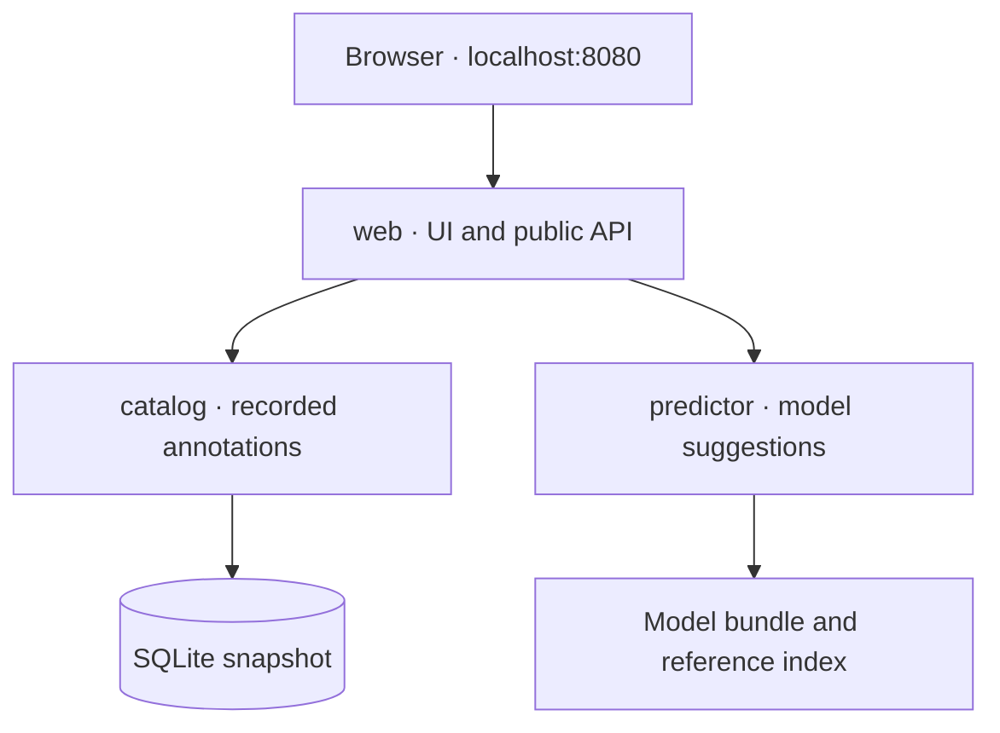

# Run the chemical function app as separate containers

This package adds three HTTP services to the existing project. They use your populated SQLite catalog and saved benchmark model. Starting the app does not collect data, fit a classifier, or rerun the benchmark.

| Service / image target | Responsibility | Its data |
|---|---|---|
| `web` | Browser interface and public API; calls the two backends over HTTP | No database or model |
| `catalog` | Chemical search, recorded uses, and source references | Read-only SQLite snapshot |
| `predictor` | SMILES validation, fingerprints, model scoring, and reference retrieval | Saved model bundle and run manifest |
| `pipeline` (optional image) | One-off preparation and training commands | Host inputs/outputs supplied explicitly |



The catalog has its own container because its API, data, and update cycle form a useful service boundary. SQLite is a file inside that service, so there is no separate database server container. The web container does not read the file directly. PostgreSQL can later replace the catalog's storage while the web-facing endpoints remain stable.

## Start here in WSL

Extract the contents of the ZIP's `industrial-use-starter` folder into your existing `~/src/industrial-use-starter` project. It adds files; it does not include or replace your database, trained model, existing benchmark code, or source exports.

You need Docker Engine with the Compose v2 plugin available in WSL. Docker Desktop with integration enabled for your WSL distribution is another way to provide that engine. These commands check whether it is available:

```bash
docker version
docker compose version
```

Then, from the project:

```bash
cd ~/src/industrial-use-starter
python3 containers/preflight.py
docker compose up --build -d --wait --wait-timeout 180
```

Open **http://localhost:8080** from your Windows browser. Search for `ethanol`, or submit `CCO` in the SMILES field.

The first build downloads the Python image and pinned dependencies. Once built, these services do not download models or contact EPA at startup. The host's Python virtual environment is not used by the containers, so you do not need to activate it for `docker compose`.

If port 8080 is busy:

```bash
APP_PORT=8088 docker compose up --build -d --wait --wait-timeout 180
```

Then open http://localhost:8088 and pass that URL to the smoke test below.

## Confirm the whole request path

```bash
python3 containers/smoke_test.py
docker compose ps
```

The smoke test goes through the web gateway. It checks backend readiness, catalog counts, ethanol search, source annotations, SMILES canonicalization, model scores, exact catalog retrieval, and rejection of a multicomponent input. The host needs only standard-library Python for this test.

You can also inspect the API directly:

```bash
curl -s http://localhost:8080/api/catalog/summary
curl -s http://localhost:8080/api/model
curl -s http://localhost:8080/api/predict \
  -H 'Content-Type: application/json' \
  -d '{"smiles":"CCO","top_k":3}'
```

The prediction response keeps two fields separate: `prediction` contains model rankings and references; `catalog_lookup` contains exact matches from the broader catalog. A missing catalog entry means unknown, not a negative function label. If the catalog is temporarily unavailable after startup, the gateway can still return a prediction with `catalog_lookup.status` set to `unavailable`.

## What happens when you build and start

`Dockerfile` has named build targets. Compose selects `catalog`, `predictor`, and `web`, producing three images from the shared source. The catalog image embeds the database snapshot. The predictor image embeds `model_bundle.joblib` and its `run_manifest.json`. New data or a promoted model therefore requires rebuilding the affected image; it is not silently swapped during serving.

The predictor verifies the artifact hash, benchmark code hash, dependency versions, and dataset contract before becoming ready. It uses the original chemistry/scoring functions, caches the model and fingerprint references once, and serves one CPU-bounded prediction at a time. Single-thread probability accumulation may differ from the parallel CLI at floating-point rounding precision. No GPU is required.

Compose creates a private service network. The names `catalog` and `predictor` become backend DNS names. Only `web` publishes a host port, bound to loopback for this local proof of concept. Its `CATALOG_URL` and `PREDICTOR_URL` environment variables identify the upstream services.

Each service has `/healthz` for process liveness and `/readyz` for readiness. Catalog startup validates the database; predictor startup validates and loads the model. Web readiness checks both backends. Compose waits for healthy backends before starting the gateway. Readiness reports failures; it is not a mechanism that repairs an unhealthy service.

Runtime images use a numeric non-root user, port 8080, readable application files, and no application-directory writes. Compose supplies a read-only root filesystem and temporary `/tmp`. These choices prepare the images for later OpenShift work; they have not been validated against a cluster or its SCCs. No fixed UID should be added to future OpenShift pod manifests without considering the namespace's assigned range.

## Data and dependency prerequisites

The preflight command requires the existing files below and checks their consistency:

```text
data/catalog/chemicals.sqlite3
runs/benchmark-v1/model_bundle.joblib
runs/benchmark-v1/run_manifest.json
benchmark.py
requirements-structures.txt
requirements-benchmark.txt
```

The Docker build also uses the existing `audit_cpdat.py`, `validate_structures.py`, `audit_diversity.py`, and `catalog_db.py`. The optional pipeline target uses the existing import/collection scripts and policy files. Keep the original project files in place. If the database is missing, extract the previously supplied database package or rebuild it from your curated data with `python3 catalog_db.py build`.

The model dependencies keep the existing exact version pins. `requirements-services.txt` separately pins the HTTP runtime. Do not downgrade or upgrade scikit-learn just to make an image build; the saved model has an environment contract. The tested host environment is Python 3.12 on Linux x86_64, matching your WSL machine. Other architectures have not been verified.

`.dockerignore` includes only selected code, policies, the catalog snapshot, and the two model artifacts. It excludes source exports, virtual environments, and unrelated experiment files from the build context. The image base uses a Python 3.12 Debian tag; an image digest and package hashes are not locked in this initial container setup.

## Logs, rebuilding, and stopping

```bash
docker compose logs --tail=80 web catalog predictor
docker compose logs -f predictor
docker compose build predictor
docker compose up -d --wait
docker compose down
```

`down` removes these local containers and the Compose network. Your source files, database, and saved model remain in the project. There are no runtime writable database volumes in this version. To use updated source data, build a new catalog snapshot upstream and rebuild the catalog image. Do not directly edit the database inside a running container.

If preflight fails, fix the reported missing or mismatched artifact first. If an image builds but a service exits, its logs show the startup validation error. If the smoke test fails, retain its output and `docker compose logs --tail=120` for diagnosis.

## Optional batch image

Training remains a separate lifecycle. This target is available for a future deliberate experiment; it is not part of `docker compose up` and there is no reason to rerun it just to view the app.

```bash
docker build --target pipeline -t chemical-functions/pipeline:local .
docker run --rm chemical-functions/pipeline:local /app/benchmark.py --help
```

If you later want a new model run against the existing frozen dataset:

```bash
docker run --rm --user "$(id -u):$(id -g)" \
  -v "$PWD:/work" chemical-functions/pipeline:local \
  /app/benchmark.py train --project-dir /work \
  --dataset-dir /work/data/processed/benchmark-v1 \
  --run-dir /work/runs/benchmark-v2
```

This requires the existing prepared dataset and curated inputs in the mounted project. It intentionally writes a new run directory. The runtime predictor still serves `benchmark-v1`; promotion to a new artifact is an explicit later change to the build inputs and service tests.

## Verification and limits

The implementation was checked with the real catalog and model using automated HTTP tests and three real local Uvicorn processes communicating over HTTP. These cover prediction parity, source retrieval, invalid inputs, artifact mismatch, startup failure, timeouts, and backend outages. The existing audit/benchmark tests were also run. The browser script has a syntax check; no browser-driven interaction test was performed.

Docker and Podman are unavailable in the build workspace, so image builds, Compose engine validation, image health checks, resource limits, and container user permissions have not been executed there. The first Compose run in your WSL environment is still required. The included smoke test is designed to verify that run.

For optional local development tests, use a separate environment so your original chemistry environment remains intact:

```bash
python3 -m venv .venv-services
source .venv-services/bin/activate
python -m pip install -r requirements-benchmark.txt -r requirements-services.txt
python -m unittest discover -s tests -v
python containers/local_smoke.py
```

The local-process check does not substitute for container execution. Service integration tests require the real catalog/model and skip when those artifacts are absent.

This increment provides local serving and container definitions. Authentication, saved report history, CI publishing, a registry, PostgreSQL migration, and cluster manifests remain future work. Once the local container smoke test passes, the next infrastructure step is a pipeline that tests these services, builds each target, and publishes versioned images for your Ansible-provisioned cluster and GitOps deployment.

References: [FastAPI containers](https://fastapi.tiangolo.com/deployment/docker/), [Compose services](https://docs.docker.com/reference/compose-file/services/), [scikit-learn persistence](https://scikit-learn.org/stable/model_persistence.html), [OpenShift image guidance](https://docs.redhat.com/en/documentation/openshift_container_platform/4.14/html/images/creating-images).
